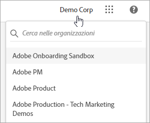
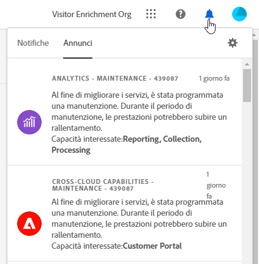
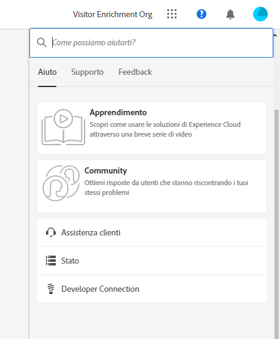

# Introduzione all’utilizzo di CX Enterprise {#get-started}

Accedi a [Adobe CX Enterprise](https://experience.adobe.com) per avviare le tue applicazioni, quindi utilizza l&#39;intestazione unificata per gestire il tuo profilo, controllare le notifiche e trovare aiuto, il tutto da un&#39;unica posizione.

## Prima di iniziare {#before-you-begin}

È necessario un Adobe ID che sia stato fornito per i prodotti CX Enterprise della tua organizzazione. Se non riesci ad accedere o a visualizzare le applicazioni previste, contatta il tuo [!UICONTROL CX Enterprise] [amministratore](administration/admin-console.md).

## Accedere a CX Enterprise {#sign-in}

Accedi e verifica di essere nell&#39;[organizzazione](administration/organizations.md) corretta.

1. Passa a [Adobe CX Enterprise](https://experience.adobe.com).
1. Digita il tuo indirizzo e-mail Adobe, quindi fai clic su **[!UICONTROL Continua]**.
1. Fai clic su un account.
1. Digita la tua password.
1. Verifica di essere nell’organizzazione giusta.

   

   **Verifica l’organizzazione**

   L’[organizzazione](administration/organizations.md) viene visualizzata nell’intestazione dell’interfaccia.

   Se la tua organizzazione utilizza Federated ID, CX Enterprise ti consente di accedere con il Single Sign-On della tua organizzazione senza dover immettere l’indirizzo e-mail e la password. Aggiungi `#/sso:@domain` all&#39;URL di CX Enterprise (`https://experience.adobe.com`) per eseguire questa attività.

   Ad esempio, per un’organizzazione con Federated ID e il dominio `example.com`, imposta il link dell’URL su `https://experience.adobe.com/#/sso:@example.com`. Puoi anche passare direttamente a una specifica applicazione salvando come segnalibro o preferito l’URL seguito dal percorso dell’applicazione. Ad esempio, per Adobe Analytics: `https://experience.adobe.com/#/sso:@example.com/analytics`.

   **Nota:** l&#39;amministratore dell&#39;organizzazione può limitare l&#39;accesso ai prodotti Adobe per indirizzo IP. In tal caso, potresti ricevere un errore dopo aver effettuato l’accesso a CX Enterprise o essere passato a un’organizzazione con questa opzione abilitata. Ulteriori informazioni sono disponibili in [Limitare l&#39;accesso ai prodotti per indirizzi IP](https://helpx.adobe.com/enterprise/using/ip-based-access.html).

## Accedere alle applicazioni CX Enterprise {#applications}

Dopo aver effettuato l’accesso a CX Enterprise, puoi accedere rapidamente a tutte le applicazioni, i servizi e le organizzazioni dall’intestazione unificata.

Per accedere alle applicazioni e ai servizi CX Enterprise per i quali disponi dei diritti di accesso nella tua organizzazione, passa al selettore delle applicazioni .

## Gestione del profilo utente {#profile}

Nel menu [!UICONTROL Profilo] puoi:

* Specificare un tema scuro (non tutte le applicazioni supportano questo tema)
* Gestisci [Preferenze](features/account-preferences.md) CX Enterprise
* Selezionare o cercare un’[Organizzazione](administration/organizations.md)
* Visualizza [!UICONTROL Note legali]
* Uscire
* Configurare preferenze, notifiche e abbonamenti dell’account

## Visualizzare notifiche e annunci interni al prodotto {#notifications}

Fai clic sull’icona a forma di campana per visualizzare notifiche e annunci. Gli annunci possono riferirsi ad aggiornamenti rilevanti e fruibili, inclusi rilasci di prodotto, avvisi di manutenzione, elementi condivisi e richieste di approvazione.

Per gestire notifiche e avvisi, vedere [Preferenze account e notifiche](features/account-preferences.md).

## Ottenere assistenza e supporto {#help}

Accedi all&#39;apprendimento e alla guida utilizzando il **[!UICONTROL Centro assistenza]** () nell&#39;intestazione, incluso il contenuto della guida (documentazione, tutorial e corsi) in [Experience League](https://experienceleague.adobe.com/?lang=it#home), nonché risorse aggiuntive per le singole applicazioni. Puoi anche inviare feedback aperti e creare ticket di supporto con priorità.

Il menu [!UICONTROL Guida] consente inoltre di accedere a:

* **[!UICONTROL Supporto]:** Crea un ticket di supporto o contatta il [!UICONTROL Supporto] tramite Twitter.
* **[!UICONTROL Feedback]:** Condividi feedback sulla tua esperienza con CX Enterprise. Il tuo feedback viene utilizzato per migliorare i prodotti e i servizi di Adobe.
* **[!UICONTROL Stato]:** Passa a `https://status.adobe.com/experience_cloud`, verifica lo stato operativo del prodotto e [!UICONTROL Gestisci abbonamenti].
* **[!UICONTROL Developer Connection]:** Navigazione a `adobe.io` e ricerca la documentazione per gli sviluppatori.

## Ulteriori informazioni su questo argomento {#more-help}

* [Gestione di utenti e prodotti in Admin Console](administration/admin-console.md)
* [Introduzione al servizio People](services/getting-started.md)
* [Preferenze e notifiche dell’account](features/account-preferences.md)
